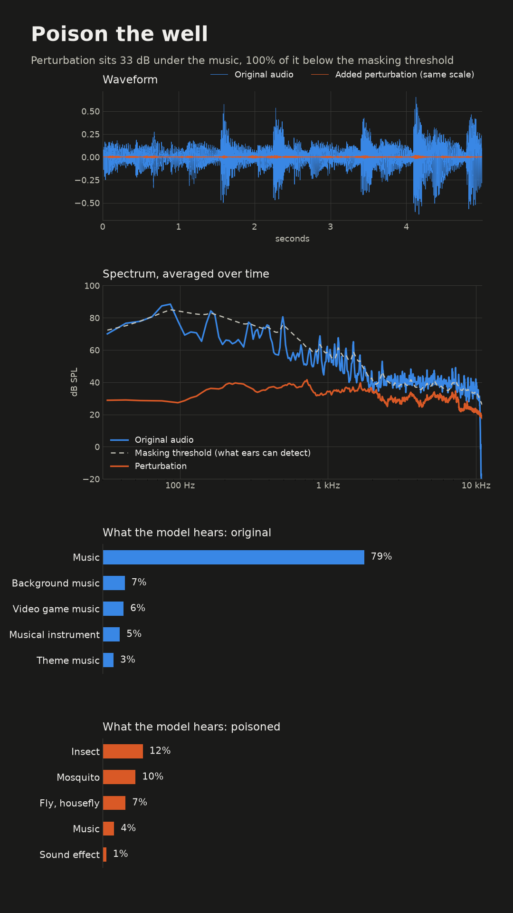

# Poison the well

Adds a perturbation to music that a listener should not notice but that changes
what a machine learning model hears.

    uv run python -m poison song.wav --start 30 --duration 3
    uv run python -m poison                       # demo clip
    uv run python -m poison song.wav --duration 0 --target Speech   # whole file, steered

Outputs land in `out/`: `clean.wav`, `poisoned.wav`, `ab_clean_then_poisoned.wav`
(clean, 0.4 s gap, poisoned), `perturbation_only.wav`, `report.json`, and a
1080x1920 `figure.png`.

## Reel visuals

    sh viz/build.sh out/reel

Builds, in `out/reel/viz/`, all at 1080x1920:

- `terrain.mp4` and `terrain.blend`: a 3D spectrogram. Blue wire canopy is the
  masking threshold (the quietest sound a listener could detect at each moment
  and pitch); the orange surface rising under it is the perturbation.
- `dose.mp4`: the model's labels flipping as the perturbation is scaled from 0%
  to 100%. Every bar is a real forward pass.

## How it works

1. **Surrogate model** (`poison/surrogate.py`). An Audio Spectrogram Transformer
   trained on AudioSet. Its front end is rebuilt in differentiable torch ops so
   gradients reach individual samples.
2. **Masking threshold** (`poison/psycho.py`). For each STFT frame of the clean
   audio: find tonal maskers, spread them over the Bark scale, combine with the
   threshold of hearing. Sound below that curve is hidden by the music.
3. **Attack** (`poison/attack.py`). Stage one: gradient steps until the model no
   longer recognises the clip and its embedding has moved away. Stage two: keep
   it fooled while pushing the perturbation under the masking threshold. Last, a
   hard clip attenuates any bin still above the threshold, kept only if the
   model stays fooled.
4. **Measurement** (`poison/__main__.py`). Everything in the report is measured
   on the 16 bit file written to disk, and again after an MP3 192k round trip.

## Results on the demo clip (5 s)

| | |
|---|---|
| Perturbation level | 32.8 dB under the music |
| Time-frequency bins under the masking threshold | 99.96% |
| Model's "Music" confidence | 79% clean, 3.5% poisoned, 3.6% after MP3 |
| Model's top labels after poisoning | Insect, Mosquito, Fly/housefly |
| Embedding cosine similarity, clean vs poisoned | 0.46 |

Listen for yourself: `examples/ab_clean_then_poisoned.wav` plays the clean clip,
a short gap, then the poisoned one. `examples/dose.mp4` shows the labels flipping.

## What this does and does not show

- It shows a trained model being misled at inference time, with white-box
  access to that model. It does not yet show that training on poisoned audio
  damages a model, or that the effect transfers to other architectures.
- "Imperceptible" here means "under a standard masking model". That model
  assumes loud playback and is not a listening test. Do a blind A/B on
  headphones before claiming it.
- This is the "evade" family: raise the model's error so it mishears the clip.
  The other family is cloaking, as in HarmonyCloak (Meerza, Sun & Liu, IEEE S&P
  2025), which lowers a generative model's loss so there is nothing left to
  learn from the track. Cloaking is not implemented here.
- Poisoning is friction, not a wall. Published counter-moves exist (detection,
  augmentation, adversarial training).
- Sparse, quiet material offers less masking. The `nutcracker` demo (solo
  celesta) only reaches 93% of bins masked at 21 dB.

## Credits

- Original research: Zazie Productions, "Poison in the Well: Adversarial Audio &
  Machine Listening", a Church of Malware field report. The gradient loop and
  the hard masking clip follow its schematic.
- Masking model after Qin et al. 2019, "Imperceptible, Robust, and Targeted
  Adversarial Examples for Automatic Speech Recognition", and Lin & Abdulla.
- Surrogate: `MIT/ast-finetuned-audioset-10-10-0.4593` (Gong et al. 2021).
- Demo audio: Kevin MacLeod, "Vibe Ace", CC BY, via librosa. The clips in
  `examples/` are excerpts of it, one of them modified by this tool.

Tests: `uv run pytest`
